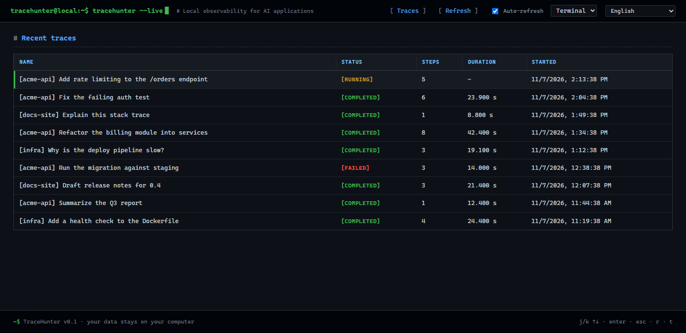
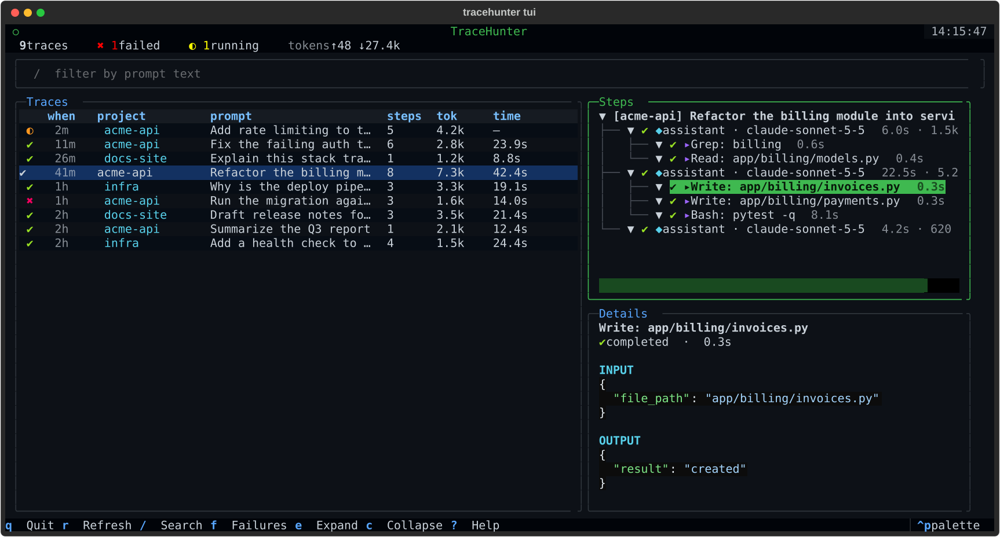

# TraceHunter

Local-first observability for AI applications. Record what your LLM, RAG or agent code
does step by step, keep the traces on your own machine and browse them in a small web UI.

> **Status: alpha (0.1).** The core library and the viewer work. Evaluation, cost tracking,
> prompt/model comparison and OpenTelemetry export are planned, not built yet.

## Why

When an AI feature answers wrong you need to know *where* it failed: retrieval, the model, a
tool call or validation. TraceHunter records each step as a span inside a trace, with timing,
inputs, outputs and errors, and stores everything in a local SQLite file. Nothing is sent
anywhere.

## Screenshots

Demo data, nothing real:





## Install

```bash
# library + web viewer + terminal UI, straight from GitHub
pip install "tracehunter[server,tui] @ git+https://github.com/victorhuggomed2006-ux/TraceHunter"

# library only (no fastapi, uvicorn or textual)
pip install "tracehunter @ git+https://github.com/victorhuggomed2006-ux/TraceHunter"
```

Python 3.10 or newer. Each [release](https://github.com/victorhuggomed2006-ux/TraceHunter/releases) also has a
wheel you can install with `pip install <file>.whl`. A PyPI package (`pip install tracehunter`) is planned.

## Use

```python
from tracehunter import SQLiteTraceRepository, Tracer

tracer = Tracer(SQLiteTraceRepository("tracehunter.db"))


@tracer.observe()  # one span per call; works with sync and async functions
def retrieve(question: str) -> list[str]:
    return ["doc-1", "doc-2"]


with tracer.trace("answer a question"):  # one trace per request/flow
    docs = retrieve("what is RAG?")
    with tracer.span("call model", {"prompt": "..."}) as span:
        span.complete({"tokens": 120})
```

Open the viewer:

```bash
python -m tracehunter tracehunter.db    # or: tracehunter tracehunter.db
# http://127.0.0.1:8000
```

See [`examples/`](examples) for runnable scripts, including one that fills a database with demo traces.

The interface has 18 languages, picked automatically from your browser (you can change it in the top bar), and
refreshes by itself.

### Terminal UI

```bash
# needs the `tui` extra (see Install above)
tracehunter tui claude.db --claude-code
```

A full-screen terminal app (built on [Textual](https://github.com/Textualize/textual)): the trace list on the
left, the span tree and details on the right. Press `?` inside for the full key list. Main keys: `↑↓` or `j`/`k`
move, `Enter` opens the steps, `Tab` switches panel, `/` searches, `f` shows failures only, `q` quits. The mouse works too.
It is read-only and needs no browser.

### Watch Claude Code live

```bash
python -m tracehunter claude.db --claude-code     # reads ~/.claude/projects, read-only
```

Each prompt you type becomes a trace; every model reply and tool call is a step (tools are nested under the
reply that called them). Only short summaries are stored (each tool result is cut at 300 characters) and the
model's private reasoning is never copied. Common secret formats are masked on a best-effort basis, but a file the
assistant read (a `.env`, for instance) can still end up in the database, so **treat the database as sensitive**.
It stays on your machine and is created with restricted permissions.

### What gets recorded

- `@tracer.observe()` records arguments **by name** (each `repr` capped at 1000 characters) and the result.
  Arguments whose name contains `key`, `token`, `secret`, `password`, `authorization`, `credential`
  or `cookie` are masked as `***`. Use `@tracer.observe(capture_io=False)` to record neither inputs nor outputs.
- Exceptions mark the span and the trace as `FAILED` and are re-raised untouched. A failure while
  saving a trace is logged and never hides your exception or breaks your code.
- Generators are not supported by `observe`; open a `tracer.span()` inside them.
- A decorated function called with no active trace just runs, untraced; instrumentation never raises. A new
  thread does not inherit the current trace, so calls made there are not recorded unless you run them with
  `contextvars.copy_context().run(...)`.

## Privacy and security

Traces can contain prompts, documents and model answers. Treat the database file like sensitive data.

- The web viewer has **no authentication**. It listens on `127.0.0.1` by default and only answers to
  `127.0.0.1`, `localhost` and `[::1]` in the `Host` header (this blocks DNS rebinding).
  Setting `TRACEHUNTER_HOST` to a non-loopback address exposes your traces to the network; the server
  warns you when you do. See [SECURITY.md](SECURITY.md).
- Responses carry a strict Content-Security-Policy and other hardening headers.

## Docker

```bash
docker compose up --build       # http://127.0.0.1:8000, data in the tracehunter-data volume
```

The compose file publishes the port on `127.0.0.1` only. Keep it that way unless you add authentication in front.

## Development

```bash
uv venv && uv pip install -e ".[dev]"
python -m pytest                  # tests (includes property-based tests with Hypothesis)
ruff check . && ruff format --check . && mypy
bandit -r tracehunter -c pyproject.toml
```

CI also runs Semgrep, gitleaks, pip-audit, Trivy, Grype, Checkov, KICS, OWASP ZAP and a load test.
See [CONTRIBUTING.md](CONTRIBUTING.md).

## Catalog of AI CLIs

`tracehunter.catalog` lists AI command-line tools and where each stores its session history, with a
confidence level per entry. Only entries marked as verified were checked on a real machine; the
rest come from vendor documentation or third-party sources and must be confirmed before use.
A collector for Claude Code already exists (see above); collectors for the other tools are planned.

## License

[MIT](LICENSE)
